<div align="center">

<picture>
  <source media="(prefers-reduced-motion: reduce)" srcset="assets/cover-poster.png">
  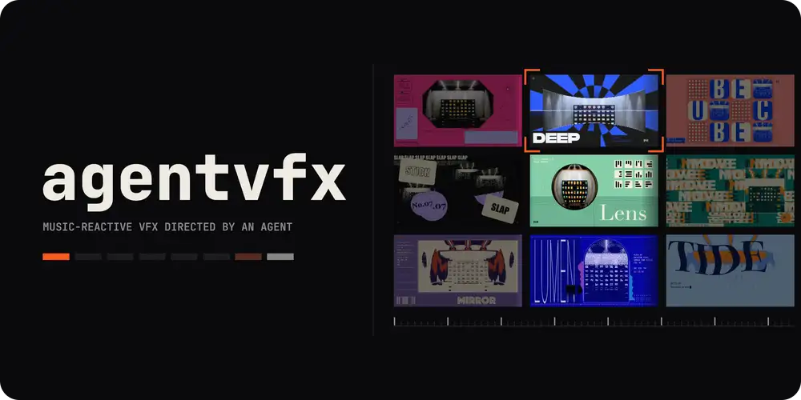
</picture>

**Music-reactive VFX, directed by your coding agent.**

<a href="LICENSE"></a>


<a href="https://agentvfx.vercel.app"></a>

**[agentvfx.vercel.app](https://agentvfx.vercel.app)** · [Showreel](#-showreel) · [Install](#-install) · [Try it in your browser](#-try-it-in-your-browser) · [Gallery](#-gallery) · [How it works](#-how-it-works) · [Flash safety](#%EF%B8%8F-flash-safety)

</div>

You describe the clip. The agent writes a short FX score (template, preset, a few parameters, which part of the music drives what), renders it with WebGL2 in headless Chrome, encodes it with ffmpeg and checks every frame for dangerous flashing before it shows you anything. Backgrounds come from procedural Blender scenes. The same templates also run live in a web page, and the [site](https://agentvfx.vercel.app) runs them in yours.

## 🎬 Showreel

<div align="center">
<a href="assets/showreel.mp4">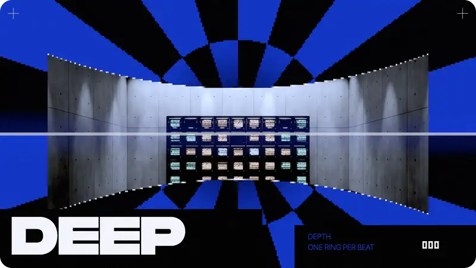</a>
<br><sub>Nine looks cut on the beat over one Blender backdrop. <a href="assets/showreel.mp4"><b>Watch the 1080p version</b></a> (silent).</sub>
</div>

## 📦 Install

agentvfx is a single agent skill, so any agent that reads skills can use it. The quickest way works for most of them:

```sh
npx skills add wjgoarxiv/agentvfx
```

Or use your agent's own plugin command:

| Agent | Command |
| --- | --- |
| Claude Code | `/plugin marketplace add wjgoarxiv/agentvfx`<br>`/plugin install agentvfx@agentvfx` |
| Codex CLI | `codex plugin marketplace add wjgoarxiv/agentvfx`<br>`codex plugin add agentvfx@agentvfx` |
| Gemini CLI | `gemini extensions install https://github.com/wjgoarxiv/agentvfx` |
| GitHub Copilot CLI | `copilot plugin install wjgoarxiv/agentvfx` |
| Qwen Code | `qwen extensions install wjgoarxiv/agentvfx` |
| Pi | `pi install git:github.com/wjgoarxiv/agentvfx` |

<details>
<summary>Other agents, or no installer</summary>

Clone the repository and point your agent at `AGENTS.md`. It names the skill file and the folder to run commands from.

```sh
git clone https://github.com/wjgoarxiv/agentvfx
```

The repository also carries plugin manifests for Cursor, Kimi, Antigravity and Devin (`.cursor-plugin/`, `.kimi-plugin/`, `.antigravity-plugin/`, `.devin-plugin/`).

</details>

Then ask for something like *"a 4-second neon lattice that hits on the kick of this track, looping, 1080p"*.

### Requirements

- Node.js 20 or newer. There is no `npm install` step and no runtime dependency.
- Google Chrome or Chromium with GPU WebGL2 (`CHROME_PATH` to override)
- ffmpeg and ffprobe (`FFMPEG_PATH`, `FFPROBE_PATH`)
- Blender 5.x, only for background plates (`BLENDER_PATH`)

## 🕹 Try it in your browser

The site at **[agentvfx.vercel.app](https://agentvfx.vercel.app)** runs the templates live with WebGL2. Nothing is uploaded and no sound plays unless you pick a file of your own.

| Page | What you get |
| --- | --- |
| [Home](https://agentvfx.vercel.app) | A live hero you play with the pointer. Click for a hit; keys 1 to 4 switch looks. |
| [Gallery](https://agentvfx.vercel.app/gallery/) | Every example reel with the exact prompt and FX score that made it, one click to copy. |
| [Matrix](https://agentvfx.vercel.app/matrix/) | Every browser-ready template × preset, 168 in all, drawn as stills. Hover one to see it move. |
| [Cookbook](https://agentvfx.vercel.app/cookbook/) | Recipes by genre, mood and format: stacks, beat hits, cuts and palettes as ready scores. |
| [Playground](https://agentvfx.vercel.app/playground/) | Build a score: pick any of the 41 templates that run in the browser (collage renders locally only), stack layers, program hits, bring your own words, track or clip, then copy the score, the prompt or a share link. |

Paste the copied prompt into your agent and it renders the full clip on your machine.

## ✨ What it makes

<table>
<tr>
<td width="33%" valign="top"><b>Beat-locked clips</b><br>3 to 5 second renders at up to 1080p 60 fps. Bass, onsets, beats and frequency bands drive each template's parameters.</td>
<td width="33%" valign="top"><b>Seamless loops</b><br>Ping-pong loops for stage screens and social posts, checked for flashing across the loop point too.</td>
<td width="33%" valign="top"><b>Blender backdrops</b><br>Procedural scenes rendered from code, used as plates under the WebGL layers.</td>
</tr>
<tr>
<td valign="top"><b>Footage looks</b><br>Run a template over your own video and audio, starting at any second.</td>
<td valign="top"><b>Live web export</b><br>The templates as a self-contained module for your site: hero backgrounds, hover hits, and visuals that follow any audio element you connect.</td>
<td valign="top"><b>Flash audit</b><br>Every frame is measured against photosensitivity limits; broadcast-safe mode refuses to export a failing clip.</td>
</tr>
</table>

## 🖼 Gallery

Twenty reels from the site, rendered by the skill at 1080p and looped silently: four seconds forward, then backward. Click one to open its page with the prompt and FX score that made it. A music track drove the motion while rendering; no audio is distributed, and every score points at `your-track.mp3`, so any track works.

> [!WARNING]
> `signal-cut` is a strobe cut on purpose and exceeds the WCAG 2.3.1 flash limit. It shows as a still here; its page asks before it plays.

<!-- gallery:start -->
### Families

<table>
<tr><td align="center" width="33%"><a href="https://agentvfx.vercel.app/r/boot-log/"></a><br><sub><code>boot-log</code></sub></td><td align="center" width="33%"><a href="https://agentvfx.vercel.app/r/collage/"></a><br><sub><code>collage</code></sub></td><td align="center" width="33%"><a href="https://agentvfx.vercel.app/r/halftone-field/"></a><br><sub><code>halftone-field</code></sub></td></tr>
<tr><td align="center" width="33%"><a href="https://agentvfx.vercel.app/r/hud-deck/"></a><br><sub><code>hud-deck</code></sub></td><td align="center" width="33%"><a href="https://agentvfx.vercel.app/r/block-glitch/"></a><br><sub><code>block-glitch</code></sub></td><td align="center" width="33%"><a href="https://agentvfx.vercel.app/r/rgb-split/"></a><br><sub><code>rgb-split</code></sub></td></tr>
<tr><td align="center" width="33%"><a href="https://agentvfx.vercel.app/r/vhs/"></a><br><sub><code>vhs</code></sub></td><td align="center" width="33%"><a href="https://agentvfx.vercel.app/r/signal-cut/"></a><br><sub><code>signal-cut</code> ⚠️ flashing</sub></td><td align="center" width="33%"><a href="https://agentvfx.vercel.app/r/speedline-burst/"></a><br><sub><code>speedline-burst</code></sub></td></tr>
<tr><td align="center" width="33%"><a href="https://agentvfx.vercel.app/r/god-rays/"></a><br><sub><code>god-rays</code></sub></td><td align="center" width="33%"><a href="https://agentvfx.vercel.app/r/lens-flare/"></a><br><sub><code>lens-flare</code></sub></td><td align="center" width="33%"><a href="https://agentvfx.vercel.app/r/neon-saber/"></a><br><sub><code>neon-saber</code></sub></td></tr>
<tr><td align="center" width="33%"><a href="https://agentvfx.vercel.app/r/echo-flow/"></a><br><sub><code>echo-flow</code></sub></td><td align="center" width="33%"><a href="https://agentvfx.vercel.app/r/kaleido-fold/"></a><br><sub><code>kaleido-fold</code></sub></td><td align="center" width="33%"><a href="https://agentvfx.vercel.app/r/tidal-bands/"></a><br><sub><code>tidal-bands</code></sub></td></tr>
<tr><td align="center" width="33%"><a href="https://agentvfx.vercel.app/r/scope-polar/"></a><br><sub><code>scope-polar</code></sub></td><td align="center" width="33%"><a href="https://agentvfx.vercel.app/r/spectrogram-scroll/"></a><br><sub><code>spectrogram-scroll</code></sub></td><td align="center" width="33%"><a href="https://agentvfx.vercel.app/r/xy-phosphor/"></a><br><sub><code>xy-phosphor</code></sub></td></tr>
<tr><td align="center" width="33%"><a href="https://agentvfx.vercel.app/r/label-bars/"></a><br><sub><code>label-bars</code></sub></td><td align="center" width="33%"><a href="https://agentvfx.vercel.app/r/spectrum-particles/"></a><br><sub><code>spectrum-particles</code></sub></td><td align="center" width="33%"><a href="https://agentvfx.vercel.app/r/spectrum-radial/"></a><br><sub><code>spectrum-radial</code></sub></td></tr>
</table>

### Before and after

<table>
<tr><td align="center" width="33%"><a href="https://agentvfx.vercel.app/r/ba-1/"></a><br><sub><code>ba-1</code></sub></td><td align="center" width="33%"><a href="https://agentvfx.vercel.app/r/ba-2/"></a><br><sub><code>ba-2</code></sub></td><td align="center" width="33%"><a href="https://agentvfx.vercel.app/r/ba-3/"></a><br><sub><code>ba-3</code></sub></td></tr>
</table>

### Formats

<table>
<tr><td align="center" width="50%"><a href="https://agentvfx.vercel.app/r/fmt-16x9/"></a><br><sub><code>fmt-16x9</code></sub></td><td align="center" width="50%"><a href="https://agentvfx.vercel.app/r/fmt-1x1/"></a><br><sub><code>fmt-1x1</code></sub></td></tr>
<tr><td align="center" width="50%"><a href="https://agentvfx.vercel.app/r/fmt-32x9/"></a><br><sub><code>fmt-32x9</code></sub></td><td align="center" width="50%"><a href="https://agentvfx.vercel.app/r/fmt-9x16/"></a><br><sub><code>fmt-9x16</code></sub></td></tr>
</table>

### One song, many looks

<table>
<tr><td align="center" width="100%"><a href="https://agentvfx.vercel.app/r/wall/"></a><br><sub><code>wall</code></sub></td></tr>
</table>
<!-- gallery:end -->

<details>
<summary>Earlier renders (kept in the 0.3.3 commit): the Blender backdrop, the lattice and 21 collages</summary>

These 1280x720 loops left the repository tree in 0.3.4 to keep it small; they stay in the [0.3.3 commit](https://github.com/wjgoarxiv/agentvfx/tree/7dfbdd5f93bef88bf3ec4dfe533b1f87dac35bf3/reels). `lattice-vermilion-fine` and `runner` contain flashing red that exceeds common photosensitive-seizure guidelines (WCAG 2.3.1); they are marked ⚠️. Do not show them to viewers who have not been warned.

### Backdrop

A procedural Blender scene: a concrete gallery with a CRT wall, built and lit in code.

<table>
<tr><td align="center"><a href="https://github.com/wjgoarxiv/agentvfx/blob/7dfbdd5f93bef88bf3ec4dfe533b1f87dac35bf3/reels/plate-gallery.mp4">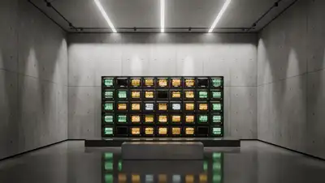</a><br><sub><code>plate-gallery</code></sub></td></tr>
</table>

### Lattice

A fine vermilion grid that bends and flares on the kick, laid over the gallery plate.

<table>
<tr><td align="center"><a href="https://github.com/wjgoarxiv/agentvfx/blob/7dfbdd5f93bef88bf3ec4dfe533b1f87dac35bf3/reels/lattice-vermilion-fine.mp4"></a><br><sub><code>lattice-vermilion-fine</code> ⚠️ flashing</sub></td></tr>
</table>

### Collages

Layered typographic compositions in mixed materials. The cells hold still; what is inside them moves with the music.

<table>
<tr><td align="center"><a href="https://github.com/wjgoarxiv/agentvfx/blob/7dfbdd5f93bef88bf3ec4dfe533b1f87dac35bf3/reels/specimen.mp4">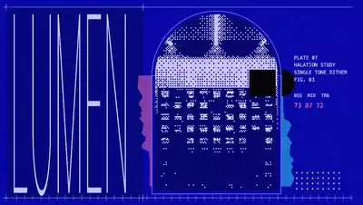</a><br><sub><code>specimen</code></sub></td><td align="center"><a href="https://github.com/wjgoarxiv/agentvfx/blob/7dfbdd5f93bef88bf3ec4dfe533b1f87dac35bf3/reels/wiring.mp4">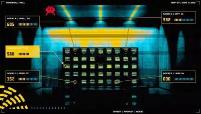</a><br><sub><code>wiring</code></sub></td><td align="center"><a href="https://github.com/wjgoarxiv/agentvfx/blob/7dfbdd5f93bef88bf3ec4dfe533b1f87dac35bf3/reels/field-cut.mp4">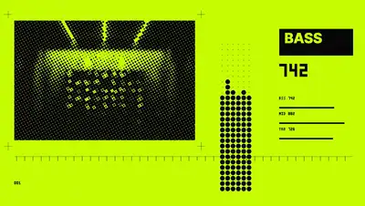</a><br><sub><code>field-cut</code></sub></td></tr>
<tr><td align="center"><a href="https://github.com/wjgoarxiv/agentvfx/blob/7dfbdd5f93bef88bf3ec4dfe533b1f87dac35bf3/reels/pattern-sheet.mp4">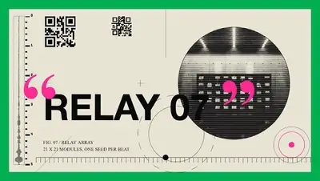</a><br><sub><code>pattern-sheet</code></sub></td><td align="center"><a href="https://github.com/wjgoarxiv/agentvfx/blob/7dfbdd5f93bef88bf3ec4dfe533b1f87dac35bf3/reels/deck.mp4">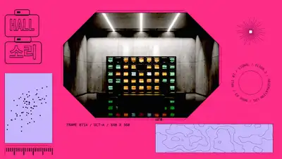</a><br><sub><code>deck</code></sub></td><td align="center"><a href="https://github.com/wjgoarxiv/agentvfx/blob/7dfbdd5f93bef88bf3ec4dfe533b1f87dac35bf3/reels/bootlog.mp4">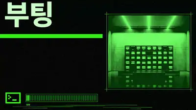</a><br><sub><code>bootlog</code></sub></td></tr>
<tr><td align="center"><a href="https://github.com/wjgoarxiv/agentvfx/blob/7dfbdd5f93bef88bf3ec4dfe533b1f87dac35bf3/reels/runner.mp4">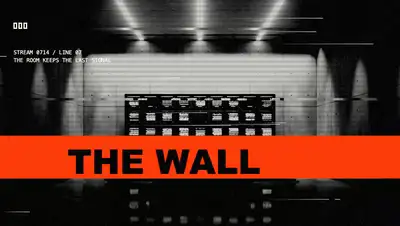</a><br><sub><code>runner</code> ⚠️ flashing</sub></td><td align="center"><a href="https://github.com/wjgoarxiv/agentvfx/blob/7dfbdd5f93bef88bf3ec4dfe533b1f87dac35bf3/reels/anatomy.mp4">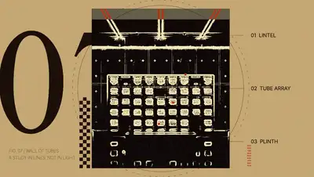</a><br><sub><code>anatomy</code></sub></td><td align="center"><a href="https://github.com/wjgoarxiv/agentvfx/blob/7dfbdd5f93bef88bf3ec4dfe533b1f87dac35bf3/reels/tunnel.mp4">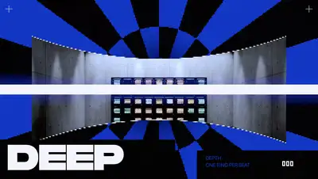</a><br><sub><code>tunnel</code></sub></td></tr>
<tr><td align="center"><a href="https://github.com/wjgoarxiv/agentvfx/blob/7dfbdd5f93bef88bf3ec4dfe533b1f87dac35bf3/reels/ascii.mp4">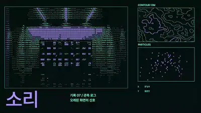</a><br><sub><code>ascii</code></sub></td><td align="center"><a href="https://github.com/wjgoarxiv/agentvfx/blob/7dfbdd5f93bef88bf3ec4dfe533b1f87dac35bf3/reels/cube-wall.mp4"></a><br><sub><code>cube-wall</code></sub></td><td align="center"><a href="https://github.com/wjgoarxiv/agentvfx/blob/7dfbdd5f93bef88bf3ec4dfe533b1f87dac35bf3/reels/frame-loop-dial.mp4">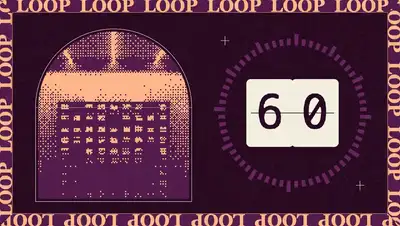</a><br><sub><code>frame-loop-dial</code></sub></td></tr>
<tr><td align="center"><a href="https://github.com/wjgoarxiv/agentvfx/blob/7dfbdd5f93bef88bf3ec4dfe533b1f87dac35bf3/reels/vortex-count.mp4">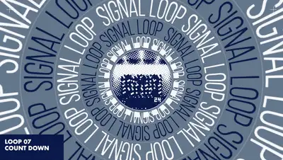</a><br><sub><code>vortex-count</code></sub></td><td align="center"><a href="https://github.com/wjgoarxiv/agentvfx/blob/7dfbdd5f93bef88bf3ec4dfe533b1f87dac35bf3/reels/slab-shear.mp4">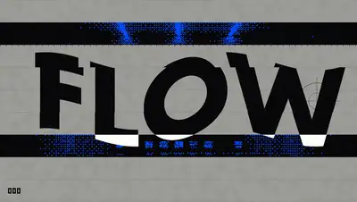</a><br><sub><code>slab-shear</code></sub></td><td align="center"><a href="https://github.com/wjgoarxiv/agentvfx/blob/7dfbdd5f93bef88bf3ec4dfe533b1f87dac35bf3/reels/sticker-slap.mp4">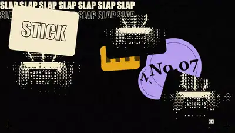</a><br><sub><code>sticker-slap</code></sub></td></tr>
<tr><td align="center"><a href="https://github.com/wjgoarxiv/agentvfx/blob/7dfbdd5f93bef88bf3ec4dfe533b1f87dac35bf3/reels/lens-wrap.mp4">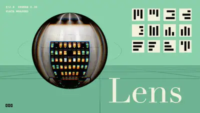</a><br><sub><code>lens-wrap</code></sub></td><td align="center"><a href="https://github.com/wjgoarxiv/agentvfx/blob/7dfbdd5f93bef88bf3ec4dfe533b1f87dac35bf3/reels/liquid-type.mp4"></a><br><sub><code>liquid-type</code></sub></td><td align="center"><a href="https://github.com/wjgoarxiv/agentvfx/blob/7dfbdd5f93bef88bf3ec4dfe533b1f87dac35bf3/reels/panel-grid.mp4">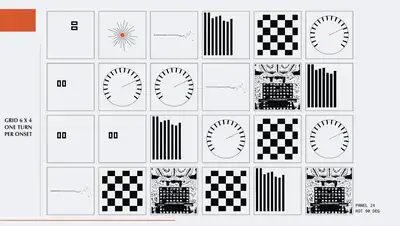</a><br><sub><code>panel-grid</code></sub></td></tr>
<tr><td align="center"><a href="https://github.com/wjgoarxiv/agentvfx/blob/7dfbdd5f93bef88bf3ec4dfe533b1f87dac35bf3/reels/marquee-stack.mp4">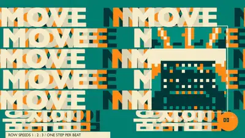</a><br><sub><code>marquee-stack</code></sub></td><td align="center"><a href="https://github.com/wjgoarxiv/agentvfx/blob/7dfbdd5f93bef88bf3ec4dfe533b1f87dac35bf3/reels/tilt-tiles.mp4">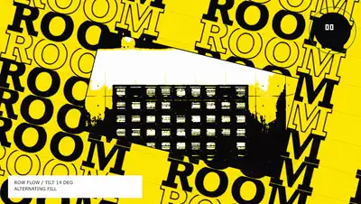</a><br><sub><code>tilt-tiles</code></sub></td><td align="center"><a href="https://github.com/wjgoarxiv/agentvfx/blob/7dfbdd5f93bef88bf3ec4dfe533b1f87dac35bf3/reels/mirror-track.mp4">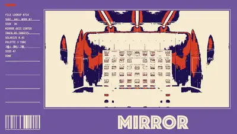</a><br><sub><code>mirror-track</code></sub></td></tr>
</table>

</details>

## 🔒 What it runs, writes and sends

- **Runs:** `node scripts/vfx.mjs` from `skills/agentvfx/`, which starts headless Chrome or Chromium (driven over `--remote-debugging-pipe`, no debugging port), `ffmpeg`/`ffprobe` to encode and analyse, and Blender 5.x only when a score asks for a background plate.
- **Writes:** renders, stills and reports into the folder passed as `--out`, plus a throwaway Chrome profile.
- **Sends:** nothing. The engine makes no outbound network requests and has no telemetry. The optional live frame server listens on `127.0.0.1` only, on a random port. Clips come from deterministic shader templates, not from a generative model.

## 🔧 How it works

Engine commands run from `skills/agentvfx/`:

```sh
cd skills/agentvfx
node scripts/vfx.mjs doctor     # checks Chrome, WebGL2, ffmpeg, Blender
node scripts/vfx.mjs list       # templates and presets
node scripts/vfx.mjs render test/fixtures/score-ok.json --out out/first --width 640 --height 360
```

Then open `out/first/stills/sheet.png`. For a footage look with the bundled demo media, try `templates/brutal/lattice/demo-vermilion.json`. [`SKILL.md`](skills/agentvfx/SKILL.md) covers scores, audio bindings, plates, loops and the web export; [`references/web.md`](skills/agentvfx/references/web.md) has the browser API.

## ⚠️ Flash safety

<details>
<summary>How flashing is measured and what the gallery passes</summary>

Strobe and impact templates can exceed photosensitivity limits on purpose, for stage use. Every render writes a flash audit. `broadcast-safe` mode enforces the limits, and `safeVariant` renders a tamed copy beside the original. Templates that can flash ship `safeSubstitute` values; the site runs them only with those values locked, and keeps flash-capable templates without safe values render-only.

All twenty-nine site reels pass the audit, including across the loop point; `signal-cut` shows its flash-safe version there. Of the earlier renders, twenty-one pass (`cube-wall` and `tilt-tiles` hold for six frames at each turn to stay inside the limit) and the two marked ⚠️ do not.

Live effects carry a flash guard: the browser runtime checks every shown frame with the audit's own detector and never shows a frame that would break the limit. It stops the effect instead, and the page can reset and resume (see [the web reference](skills/agentvfx/references/web.md)). On the site, all four hero looks and twenty-five flash-rated playground templates, with every slider pushed to three quarters of its range, were captured for ten seconds under scripted pointer input and checked with the same audit. All pass except `signal-cut`, which showed two single red transitions six seconds apart: no flash within any one second, but the audit counts the pair over the whole capture.

</details>

## 🙏 Credits

- Capture engine adapted from LitClaude lit-typographic-motion and mexicat/pdoom-video (both MIT); see [`NOTICE`](skills/agentvfx/NOTICE).
- Demo footage `clip-01.mp4` and `clip-02.mp4`: public-domain films from the Internet Archive ([sources](skills/agentvfx/test-media/SOURCES.md)). `beat-132.mp3` is generated by `scripts/make-beat.mjs`.
- Fonts are not bundled. The collages name Monument Extended, Pretendard and MesloLGS NF; without them the text falls back to generic families and looks different from the gallery.

## 📄 License

agentvfx uses the **agentvfx licence** ([`LICENSE`](LICENSE)): the PolyForm Noncommercial License 1.0.0, reproduced unchanged as Part 2, plus Additional Terms in Part 1. It is source-available, not open source.

**Free for noncommercial use, and for individual creators in their own work, commercially too.** If you are an individual (a sole proprietor or a band of individuals counts), you can run agentvfx and use the clips you render in your own work: your music video, your channel and its ads or sponsors, your own VJ or live set.

**Needs a commercial licence** (ask in [Issues](https://github.com/wjgoarxiv/agentvfx/issues)): companies and employers, client work or output made for someone else to publish, paid rendering services, selling or reselling the tool, its templates, or the clips on their own (stock, loops, packs).

**Forks need their own name.** You may not call a changed copy agentvfx or present it as the original; give it a name without "agentvfx", say it is changed from agentvfx and link back here.

**Not allowed under any permission:** training, fine-tuning or evaluating a model on the code, shaders or templates, or building a dataset for that. Having your own coding agent operate agentvfx is fine.

**Credit is required for anything you publish.** Every render burns a small `agentvfx` credit into a corner of the frame; leave it in. If you turn it off with `"credit": { "overlay": false }` in the score, put this line in the description, caption or credits instead (it is also in `CREDIT.txt` next to every film):

```text
Made with agentvfx by Woojin Go - https://github.com/wjgoarxiv/agentvfx
```

When you hand a clip to someone who will publish it, pass the credit on with it. The folder that `export-web` writes carries its own `LICENSE`; keep it with the files.

> 한국어 요약: 비상업 사용은 자유입니다. 개인(개인사업자, 개인들로 이뤄진 밴드 포함)은 자기 작품(뮤직비디오, 자기 채널의 광고와 스폰서 수익, 자기 VJ 공연)에 렌더 결과를 상업적으로도 쓸 수 있습니다. 회사, 고용주, 의뢰 작업(남이 게시할 결과물), 유료 렌더 서비스, 도구나 클립의 단독 판매, AI 학습 용도는 허용되지 않으며 상업 라이선스가 필요합니다. 코드를 고쳐 배포(포크)할 때는 "agentvfx"가 들어가지 않는 새 이름을 쓰고, agentvfx를 고친 것임을 밝히고 이 저장소 링크를 달아야 합니다. 게시하는 모든 결과물에는 크레딧이 필요합니다. 기본으로 화면 모서리에 작은 `agentvfx` 표시가 들어가며, 끄면(`"credit": { "overlay": false }`) 설명란이나 크레딧에 위 문구를 넣어야 합니다. 결과물을 남에게 넘길 때는 크레딧도 함께 전달하세요.

The parts adapted from mexicat/pdoom-video keep their MIT licence ([`NOTICE`](skills/agentvfx/NOTICE) lists the files). To cite agentvfx in a paper or write-up, use [`CITATION.cff`](CITATION.cff).

<div align="center"><sub><a href="https://agentvfx.vercel.app">Site</a> · <a href="#-showreel">Showreel</a> · <a href="#-install">Install</a> · <a href="#-gallery">Gallery</a> · <a href="skills/agentvfx/SKILL.md">SKILL.md</a> · <a href="LICENSE">License</a></sub></div>
